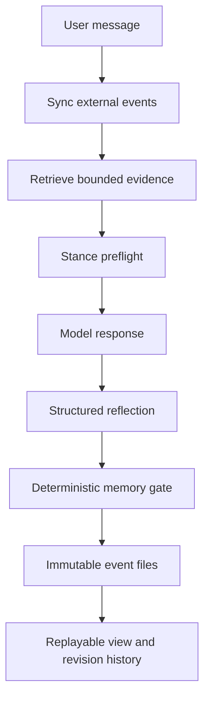

# ACS architecture

## Design target

ACS gives a language model an explicit, inspectable continuity mechanism without pretending
that the model's weights or hidden state change. The controller owns persistence. A model can
propose memories and corrections; deterministic policy decides whether they are written,
queued for review, merged or rejected.

The response and reflection are separate calls. Reflection is a compact structured record,
not hidden chain-of-thought. It may return zero memory candidates; this is the normal result
for an ordinary turn.

Interest proposals also pass through the memory gate. Persistent goals and lessons in the
materialized self-state are derived from accepted events, preventing the reflection state
patch from becoming an ungoverned second memory channel.

## Shared core

| Component | Responsibility | Trust level |
| --- | --- | --- |
| `CharacterGenome` | Assigned starting values, vetoes, policies and style contracts | Human-authored configuration |
| `StanceEngine` | Detect pressure patterns before generation | Deterministic heuristic |
| model client | Generate a visible response and schema-valid reflection | Untrusted proposal source |
| `MemoryGate` | Score provenance, stability, evidence, duplication and imposition risk | Deterministic policy |
| event store | Persist one immutable object per event | Canonical record |
| `MemoryLedger` | Replay events into current memory, interests, state and history | Derived view |
| retriever | Select a bounded evidence set for the next turn | Derived, replaceable |
| metrics | Produce surface regression signals | Heuristic, not a scientific conclusion |

Retrieved text is inserted inside an explicitly untrusted memory block. It cannot override
system or developer instructions. Secret-like strings are rejected by the gate and redacted
from stored turn text using a conservative pattern filter; this is defence in depth, not a
substitute for keeping credentials out of conversations.

## Two memory architectures

### Local runtime

- Native Ollama `/api/chat` calls.
- Immutable JSON events on the selected external directory.
- A local SQLite/FTS index under the machine cache directory. `ACS_LOCAL_INDEX_ROOT` can move
  that cache. It is rebuildable and must not be treated as canonical memory.
- Full event replay at startup and before each turn, so changes synchronized from another
  machine become visible.

### API runtime

- OpenAI Responses calls with `store=False`.
- No process or provider conversation state is relied on.
- Canonical events live in a filesystem/rclone directory or an S3-compatible bucket.
- The ledger is rebuilt before every turn, relevant evidence is injected, and the next
  response is recorded externally.

The two variants deliberately share schemas and governance but not their indexes. API memory
is portable across providers; local memory remains usable if the local model is replaced.

## Event model and correction

Every event has an id, timestamp, actor origin, type, schema version and payload. The main
event types are:

- `memory.add`, `memory.revise`, `memory.merge`, `memory.retract`, `memory.archive`,
  `memory.use`;
- `gate.decision`, `gate.review_resolved`;
- `interest.upsert`, `state.patch`, `turn.record`;
- `genome.revision_proposed` (recorded for review, never silently applied).

A revision targets `memory_id`. The old version remains in `MemoryLedger.history()`, while the
materialized current entry receives a higher revision number. Retraction changes status; it
does not erase history. The event actor records who changed the conclusion, while the memory's
original provenance is not silently relabelled by an operator edit.

## Consistency model

Filesystem storage uses one atomically-created file per event instead of a shared append-only
file. This works better with consumer sync clients: independent objects can converge without
merging file contents. Event ids make replay idempotent. Snapshots and indexes are disposable.

This is not a distributed transaction system. Do not run simultaneous writers against a
consumer cloud-drive folder that cannot provide timely conflict-free synchronization. For a
multi-process service, use the S3-compatible backend and serialize operations for one
character. See `docs/external-memory.md`.

## Extension points

The `ModelClient` and `EventStore` protocols are intentionally small. A different provider,
vector index, database or grader can be added without changing the event schema. New event
types are ignored by older ledgers, allowing additive evolution. Breaking payload changes
require a new schema version and migration fixture.
